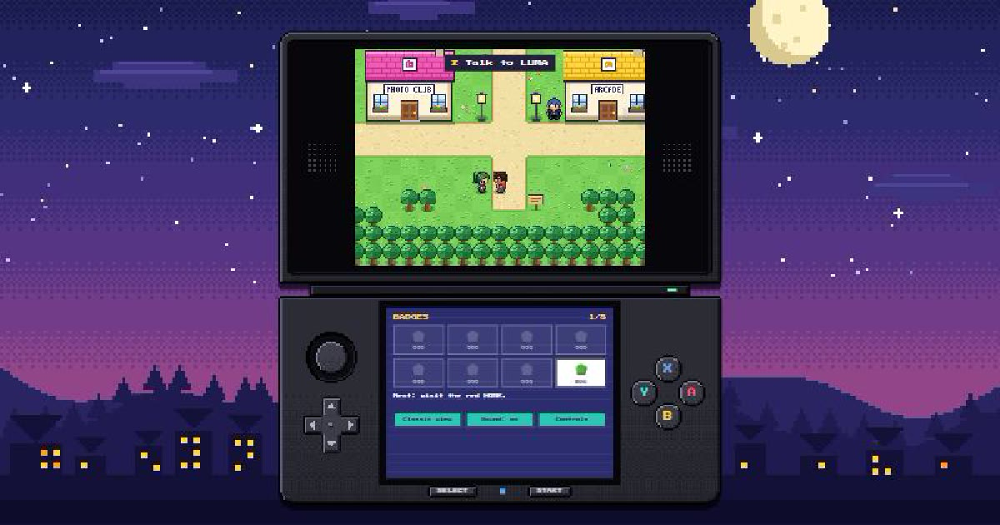

# Portfolio Town

My portfolio, built as a small top-down RPG you can play in the browser.

**Play it at [cavio.uk](https://cavio.uk)**



You walk around a town where every building is a section of the portfolio: who I am, what I've built, where I've worked and studied, and what I do outside of code. Visit them all to collect 8 badges. If you're in a hurry there is a classic one-page view with the same content.

## Features

- A tile-based town on a 256×192 canvas, with the tiles, buildings and props all drawn in code
- A pixel-art handheld console and night-sky backdrop, also drawn in code
- Grid movement, NPCs to talk to, signs to read and a typewriter dialogue system
- Seven buildings that open the portfolio sections, each awarding a badge
- Turn-based "bug battles" in the tall grass, with my real tech skills as the moves
- Console buttons (circle pad, D-pad, A/B/X/Y, Start/Select) that work with mouse and touch
- A world map travel album: hover a country to see the photos from there
- Progress saved in the browser
- A classic view for anyone who would rather just read

## Controls

| Key | Action |
| --- | --- |
| Arrow keys / WASD | Move |
| Shift (hold) | Run |
| Z / Enter / Space | Talk, read, confirm |
| X / Esc | Go back, close |

On a phone, use the on-screen D-pad and the A and B buttons.

## Running it

There is no build step. Open `index.html` in a browser, or serve the folder:

```bash
python -m http.server 8000
```

Then go to http://localhost:8000. Add `#classic` to the address to open the classic view directly.

## Project layout

```
index.html        page structure for the game and the classic view
css/style.css     all the styling
content/          the site's text and picture names, one small file per section
                  (see content/HOW-TO-EDIT.md)
js/render.js      turns the content files into the page sections
js/art.js         pixel art: tiles, buildings, props, the tiny sign font
js/shell.js       paints the console shell and the backdrop
js/worldmap.js    the travel map
js/game.js        the game: map, movement, dialogue, battles, badges
assets/photos/    photos used in the About, Contact and Travel sections
assets/sprites/   character sprite sheets and portraits
```

## Credits

Character sprites and portraits are from the TownsPeople2 pack on itch.io. The player sprite is a recolour of one of its characters.

## Tech

Plain HTML, CSS and JavaScript. No frameworks or libraries.
